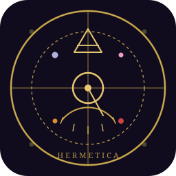
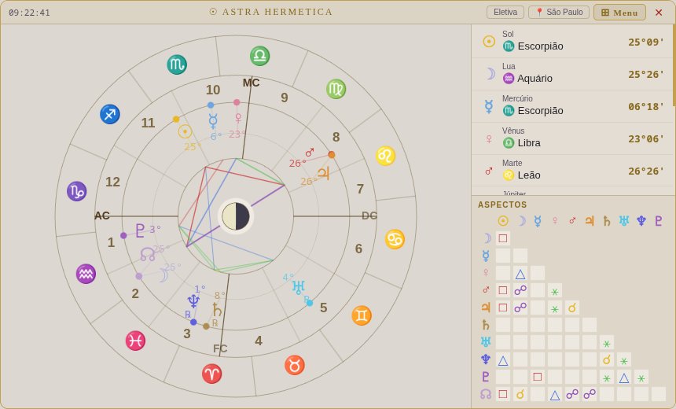
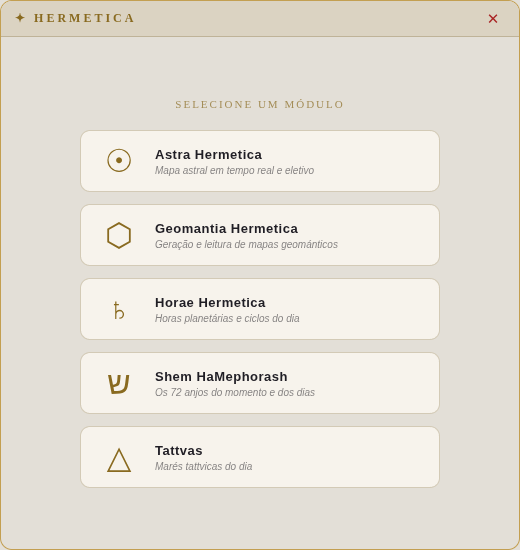
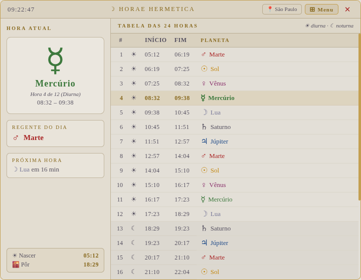
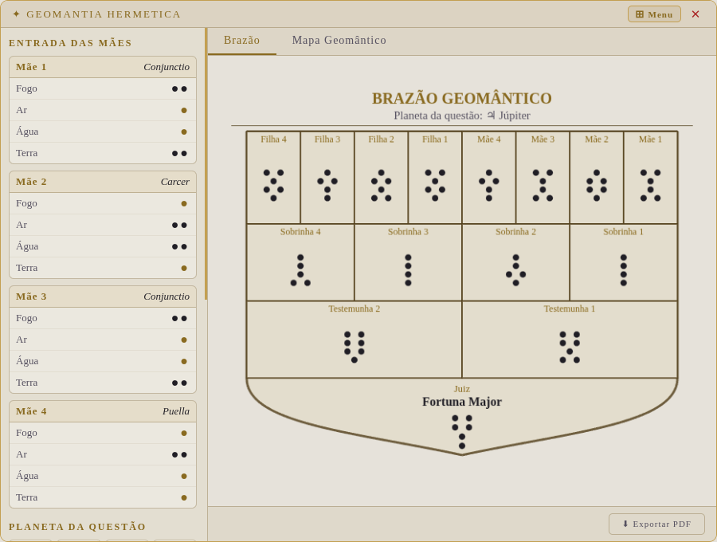
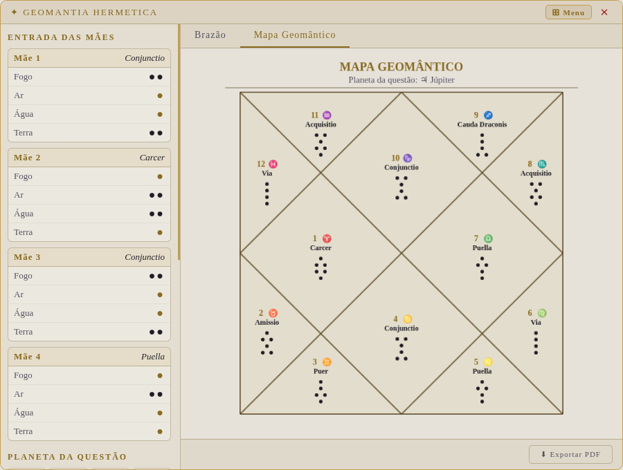
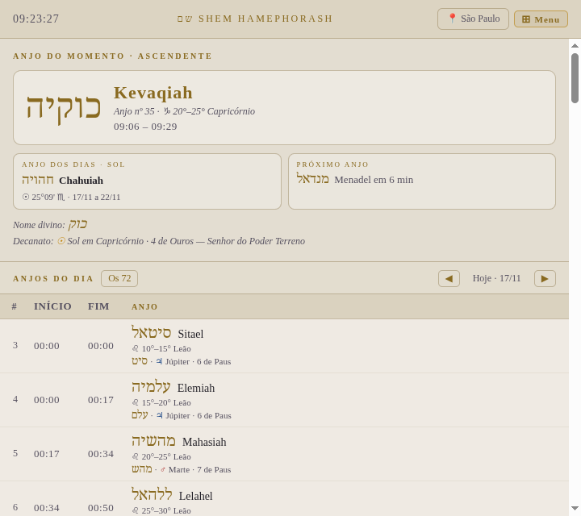
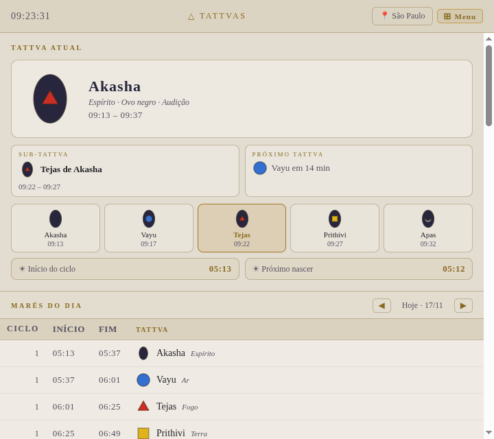

<div align="center">



# Hermetica Suite

**Ferramentas para praticantes da tradição da Golden Dawn — desktop e Android, com widgets nativos.**




</div>

## Sobre

Cinco ferramentas reunidas num só app, para Windows, Linux e Android:

| Módulo | O que faz |
|---|---|
| **Astra Hermetica** | Mapa astral em tempo real e eletivo: casas de Plácido, aspectos, retrogradação e fase da Lua |
| **Geomantia Hermetica** | Escudo geomântico e mapa nas casas pelo método da Golden Dawn, com exportação em PDF |
| **Horae Hermetica** | As 24 horas planetárias do dia, calculadas a partir do nascer e do pôr do sol do lugar |
| **Shem HaMephorash** | Os 72 anjos: o anjo do momento (pelo Ascendente) e o anjo dos dias (pelo Sol) |
| **Tattvas** | Marés tattvicas: Tattva e sub-Tattva do momento e a tabela do dia |

## Destaques técnicos

- **Motor astronômico próprio, sem bibliotecas.** Posições do Sol, da Lua (59 termos periódicos,
  Meeus cap. 47), dos planetas (elementos keplerianos do JPL), do Nodo Lunar, Ascendente, Meio do
  Céu e casas de Plácido — com nutação e ΔT. Comparado ao Planetdance, o Ascendente e as casas
  ficam a menos de 0,02′ e a maioria dos planetas a menos de 0,3′
  ([detalhes](docs/02-motor-astronomico.md#212-precisão)).
- **Funciona offline.** A internet só é usada para buscar cidades; todo o cálculo é local.
- **Um código de tela, duas plataformas.** As mesmas páginas em HTML, CSS e JavaScript puro, sem
  framework, rodam no Electron (desktop) e no Capacitor (Android). Os módulos detectam a
  plataforma e se adaptam.
- **Widgets nativos do Android em Java.** Quatro widgets de tela inicial (Astra, Horae, Shem e
  Tattvas), com o motor astronômico portado linha a linha do JavaScript e conferido para dar o
  mesmo resultado. Cada widget desenha num `Bitmap` e se atualiza sozinho no momento certo.
- **Desktop seguro.** A página não acessa o Node: `contextIsolation`, `nodeIntegration: false` e
  uma ponte mínima via `preload.js`.

## Capturas de tela

| Menu | Horae Hermetica |
|---|---|
|  |  |

| Geomantia — Brasão | Geomantia — Mapa nas casas |
|---|---|
|  |  |

| Shem HaMephorash | Tattvas |
|---|---|
|  |  |

## Rodar

```bash
# desktop
npm install
npm start

# Android
cd android
npm install
npx cap sync android
cd android && ./gradlew assembleDebug
```

## Estrutura

```
hermetica-suite/
├── main.js        ← processo principal do Electron (janela, IPC, rede)
├── preload.js     ← ponte segura entre a página e o Electron
├── renderer/      ← páginas da versão desktop (um diretório por módulo)
├── android/
│   ├── www/       ← páginas da versão Android
│   └── android/   ← projeto Android nativo (Gradle, widgets em Java)
├── assets/        ← ícones
└── docs/          ← documentação
```

## Documentação

Tudo em [docs/](docs/README.md): arquitetura, o motor astronômico explicado passo a passo, cada
módulo, os widgets, build e fontes. Há também um [tutorial passo a passo](docs/tutorial-passo-a-passo.md)
que reconstrói cada peça do app do zero.

## Licença

[MIT](LICENSE)
